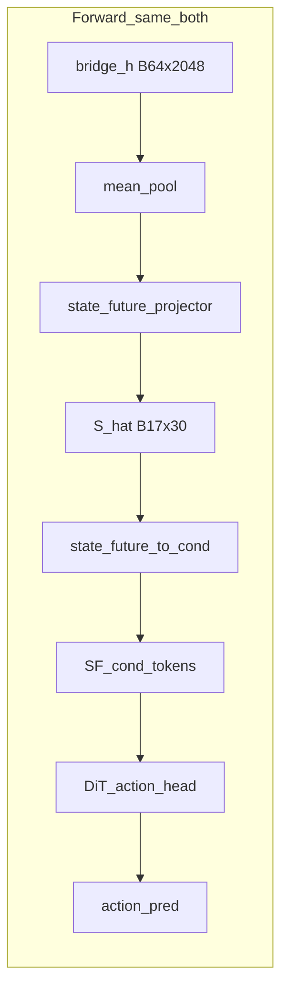
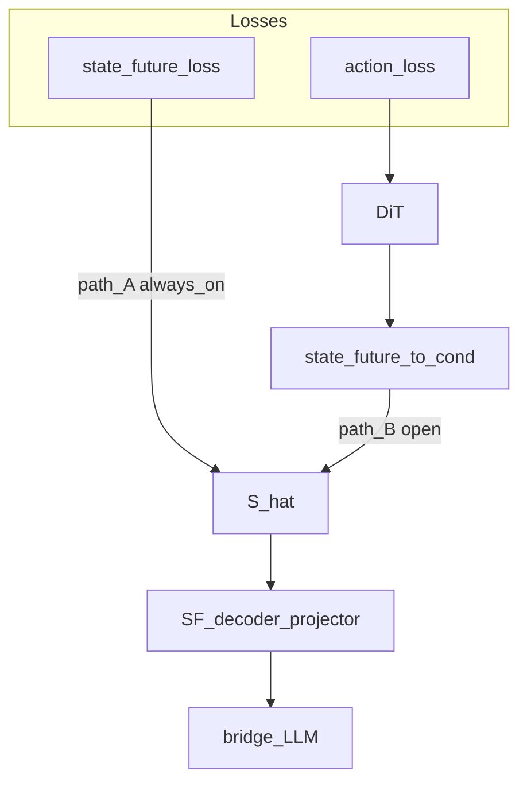
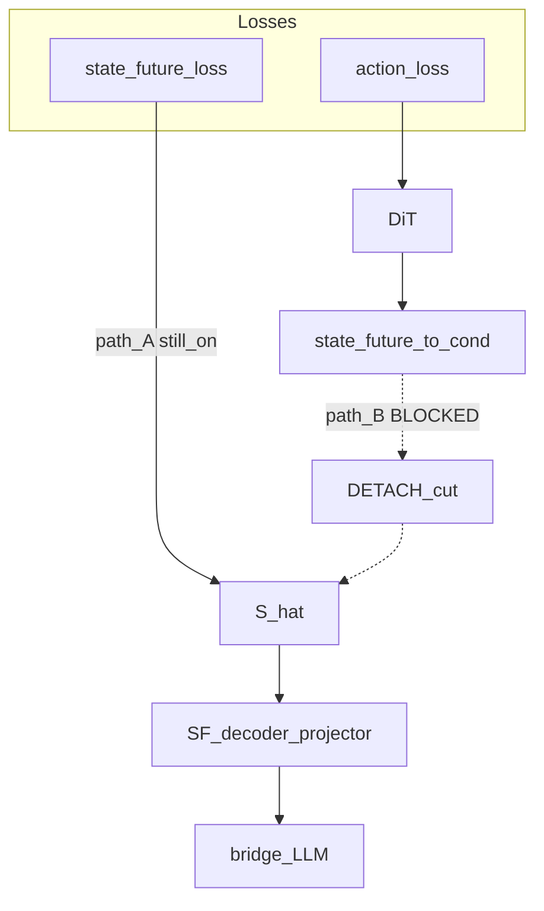

# detach 断的是什么回传：示意图说明

> 对照代码：[`gr00t/model/gr00t_n1_dial.py`](../gr00t/model/gr00t_n1_dial.py)（`sf_tokens_detach`，约 613–638 行）。  
> mean_pool 前向与 SF 监督反传见 [`mean_pool_mlp_to_llm_20261009.md`](mean_pool_mlp_to_llm_20261009.md)。

---

## 一句话答案

`sf_tokens_detach` **不断前向**，只在 \(\hat{S}\)（或 mid_hidden）**送进 DiT 条件投影之前**做一次 `.detach()`。

切断的是：

**`action_loss` → DiT → `state_future_to_cond` → \(\hat{S}\) → SF 预测头（mean_pool 下是 `state_future_projector`）→ backbone**

**不切断**的是：

- 前向：\(\hat{S}\) 仍经 `state_future_to_cond` 进 DiT（数值一样）
- SF 监督：`state_future_loss = MSE(\(\hat{S}\), S)` 仍从 \(\hat{S}\) 直接回传到 SF 头与 LLM

对应代码（mean_pool / `shat` 路径）：

```python
sf_for_cond = (
    pred_state_future.detach()
    if self.sf_tokens_detach
    else pred_state_future
)
proprio_foresight_tokens = self.state_future_to_cond(sf_for_cond) + ...
```

---

## 前向：两边表征相同



detach 只在 `Shat → ToCond` 之间插入「停梯度」；**张量数值不变**，所以诊断里 `prediction_detach_max_diff=0`、两边 loss 相同。

---

## 反传：不 detach（两条路都能改 SF 头）



- **Path A（SF 监督）**：`L_sf → Ŝ → projector → bridge/LLM` —— 永远开着
- **Path B（action 回传）**：`L_action → DiT → to_cond → Ŝ → projector → …` —— **不 detach 时开着**

诊断里不 detach：`action_to_decoder` norm > 0。

---

## 反传：detach（只断 Path B）



- Path A 仍在：SF 头仍被 `L_sf` 训练
- Path B 断开：`action_loss` **不能**再改 SF 预测头（也不能经这条路改产生 Ŝ 的 bridge）
- `state_future_to_cond` **仍能**吃到 `action_loss` 梯度（诊断 `action_to_cond` 两边都连上）——断开点在 **to_cond 的输入**，不在 to_cond 权重本身

诊断里 detach：`action_to_decoder` connected=0、norm=0。

---

## 表征比对（detach vs 不 detach）

| 量 | 不 detach | detach |
|---|---|---|
| 前向 Ŝ / SF_cond / action | 相同 | 相同 |
| Ŝ 是否 `requires_grad`（进 DiT 前） | True | False |
| \(∂L_{sf}/∂\) SF头 | 有 | 有 |
| \(∂L_{action}/∂\) SF头 | 有（弱） | **无** |
| \(∂L_{action}/∂\) `state_future_to_cond` | 有 | 有 |
| SF 是否进 DiT | 是 | 是 |

「表征」前向一致；差别只在 **谁有权用 action 误差去改 SF 头学到的表征**。

---

## 和实验现象的对应

- 训出来 action 接近：前向都在用 SF，Path B 本身又弱（诊断里 action→decoder 只有 SF 监督梯度的约 2%），断不断 Path B 对最终 action 影响小。
- 改 SF（置零/交换）action loss 仍变：证明的是 **前向依赖**，不是 Path B。
- detach 的 decoder MSE 往往更低：SF 头主要按 \(L_{sf}\) 学，少受 action 回传干扰。

---

## 易混点（澄清疑惑）

1. **不是**把 SF 从 DiT 里拿掉（那是 `p_sf_drop` / 不 `feed_state_future_to_dit`）。
2. **不是**对 `state_future_loss` detach（\(L_{sf}\) 与 Ŝ 之间没有这刀）。
3. **不是**冻住 `state_future_to_cond`（它仍被 action 更新）。
4. 断的是：**动作误差经 DiT 条件通路回流到 SF 预测头（及更上游）** 这一条。
